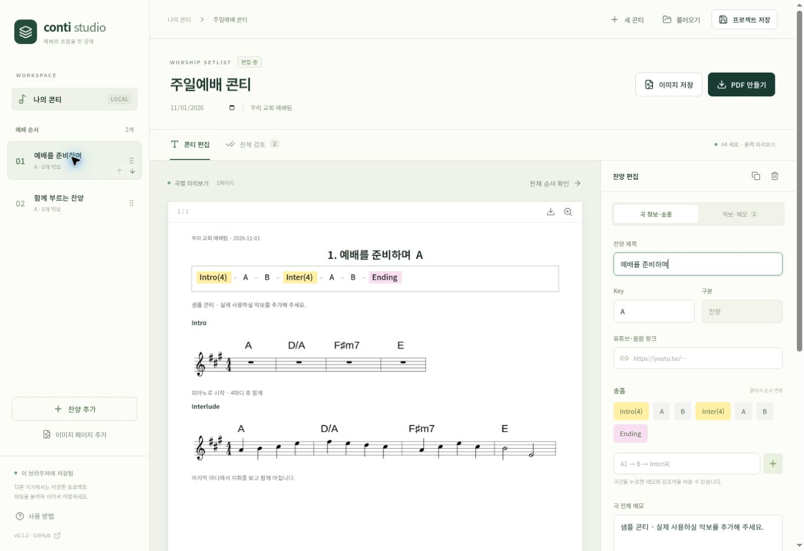

# Conti Studio

예배의 흐름을 한 장에. 송폼과 악보를 편집하고, 확인한 페이지를 PDF로 만드는 웹 도구입니다.

[웹에서 사용하기](https://conti-studio-web.vercel.app/)



## v0.4.0 · 단선 채보와 키·조성 추정

- 음원을 연결하면 장·단조와 키 후보를 브라우저에서 추정합니다.
- 추정한 키 또는 직접 선택한 키로 단선 멜로디와 코드 초안을 만듭니다.
- 조표에 맞춰 음표를 표기하며, 16분음표까지 리듬을 표현합니다.
- 키를 교정하면 실제 음높이를 유지하며 표기를 바꿉니다. ‘곡 Key에 적용’으로 곡 정보에도 반영합니다.

조성 추정은 음높이 분포와 장·단조 프로파일의 유사도를 이용합니다. ‘후보 구분’은 확률이 아니며, 관계조·전조·복잡한 편곡에서는 직접 확인해야 합니다. 음이 부족하거나 무음이면 C장조로 확정하지 않고 직접 선택하도록 안내합니다. 이 버전은 반복 구간을 접어 한 장으로 재편집하는 기능까지 제공하지는 않습니다.

### 음원 분석 사용하기

- 송폼 분석 → 구간 이름·시간 교정 → 현재 찬양의 송폼에 적용
- 간주 선택 → 음표·코드 초안 생성 → 악보를 보며 수정 → 콘티에 추가
- 전체 곡 채보 → 최대 16마디 단위로 나누어 멜로디·코드 초안 생성 → 구간별 수정·일괄 추가
- 별도 백엔드·API 키 없이 브라우저에서 처리

**음원 분석**을 누른 뒤 유튜브 링크를 넣고 **탭 소리 연결**을 선택합니다. PC Chrome·Edge의 탭 선택 창에서 **탭 오디오 공유**를 켜고 영상을 재생한 뒤 **가져오기 완료**를 누릅니다. 곡 길이만큼 재생이 필요하며, 링크만 넣어 음원을 자동 다운로드하지 않습니다. 아이폰·아이패드 등 탭 소리 공유가 지원되지 않는 환경에서는 음원 파일을 선택합니다.

송폼은 LinkSeg 모델, 간주 음표는 Spotify Basic Pitch로 분석합니다. BPM은 일정한 템포를 가정한 추정값이며 보정할 수 있습니다. A/B 명칭·경계·마디 수와 채보된 음정·리듬·코드를 확인해 주세요. 간주는 여러 악기를 분리한 원본 악보가 아닌 단선율 초안과 기본 코드 후보입니다. 음원은 50MB·10분, 악보 파일은 20MB·PDF 20쪽까지 지원합니다. 선택 구간 채보는 한 번에 1~60초·32마디, 전체 곡 채보는 최대 16마디씩 순서대로 처리합니다. 전체 곡은 기기 성능에 따라 수분 이상 걸릴 수 있습니다. 모든 악기 파트의 분리 채보나 이미지 악보에서 누락 구간을 자동 판별하는 기능은 포함되지 않습니다.

송폼과 악보는 각각 **교체/추가**를 눌러야 저장됩니다. 음원 데이터는 분석 창을 닫으면 해제되며 프로젝트 파일에 포함되지 않습니다. 처음 송폼을 분석할 때 Hugging Face에서 약 1.5MB의 공개 모델을 내려받습니다. 채보 모델과 실행 파일은 사이트가 제공하며, 버전별 주소와 장기 브라우저 캐시를 사용해 같은 파일의 반복 다운로드를 줄입니다. **합성 음원으로 기능 체험**은 실제 입력 영상의 분석 결과가 아닙니다.

## 기본 편집 기능

- 찬양 제목·Key·참고 음원 링크, 구간별 송폼과 연주 메모
- PDF·PNG·JPG·WebP 악보 불러오기
- 악보 자르기·상하 분할, 블록 사이에 악보·간주·메모 추가
- 악보 위 글씨·형광펜 표시
- 마디별 코드 또는 ABC 음표 입력으로 추가 악보 생성
- 곡·구간·페이지 순서 변경, 페이지 사이 이미지 삽입
- 페이지별 PNG, 전체 PNG ZIP, 확인 완료 후 A4 PDF 출력
- 브라우저 자동 저장, 원본을 포함한 프로젝트 파일 저장·복원

## 사용하기

1. **찬양 추가**에서 제목·Key·링크와 송폼을 입력합니다.
2. **악보·메모**에서 악보를 올립니다. PDF는 원래 페이지 순서로 불러옵니다.
3. 필요한 위치에 간주나 메모를 넣습니다. 악보 중간에 넣으려면 **나누기**로 먼저 분리합니다.
4. **전체 검토**에서 페이지 순서를 정하고, 각 페이지를 확대해 확인합니다.
5. 모든 페이지의 **확인하기**를 누른 뒤 PDF를 만듭니다. 출력 내용이 바뀐 페이지는 다시 확인해야 합니다.

파일 생성이 끝나면 **파일 다운로드**를 눌러 저장합니다.

악보는 비율을 유지하며 페이지 안에 맞춥니다. 긴 이미지가 작게 보이면 나누기를 사용해 주세요. PNG와 PDF에는 같은 출력 이미지를 사용합니다. 기본 출력은 A4, 1654×2339px(약 200dpi)입니다.

### 추가 악보

코드는 마디마다 `|`로 구분합니다.

```text
A | D/A | F#m7 | E
```

코드 악보는 입력한 코드와 마디별 쉼표를 표시합니다. 멜로디가 필요하면 **멜로디 입력**에서 ABC 표기로 음표를 작성합니다. 기본 음표 길이는 8분음표(`L:1/8`)이며, 아래 예시는 4/4박자 4마디입니다.

```text
A2 B2 c2 e2 | f2 e2 d2 c2 | A2 c2 e2 c2 | B4 E4 |
```

음원 분석에서 가져온 송폼과 간주도 같은 편집·출력 기능으로 이어집니다. 기존 악보 중간에 넣으려면 원본 악보를 먼저 나누고 간주 블록의 위치를 옮기세요.

### 저장과 전달

작업은 현재 기기의 브라우저에 저장됩니다. 브라우저 데이터가 삭제되면 자동 저장 내용도 없어질 수 있으므로, **프로젝트 저장**으로 `.conti.zip` 파일을 내려받아 보관하세요. 이 파일에는 편집 정보와 사용 중인 원본 악보가 함께 들어갑니다. 다른 기기나 팀원은 **불러오기**로 이어서 편집할 수 있습니다.

현재는 각자 작업하는 방식이며 실시간 공동 편집·공용 악보함·사용자 로그인은 제공하지 않습니다. 악보와 프로젝트 데이터는 앱 서버로 업로드하지 않고 브라우저에서 처리합니다. 웹폰트·유튜브 재생·최초 송폼 모델 다운로드는 해당 외부 서비스에 연결됩니다.

## Vercel 배포

GitHub의 `clou-dd/conti-studio` 저장소가 Vercel의 `conti-studio-web` 프로젝트에 연결되어 있습니다. `main`에 변경 사항을 올리면 Vercel이 자동으로 빌드하고 배포합니다.

| 설정 | 값 |
| --- | --- |
| Framework | Vite |
| Root Directory | 저장소 루트 |
| Install Command | `npm ci` |
| Build Command | `npm run build` |
| Output Directory | `dist` |
| Node.js | 22 LTS (22.12 이상) |
| 환경 변수 | 없음 |

`vercel.json`이 포함되어 있습니다. Git 연동 시 `main`의 변경 사항을 자동 배포할 수 있습니다. 브라우저 작업 데이터는 도메인별로 구분되므로, 미리보기 주소에서 만든 작업을 실제 서비스 주소로 옮기려면 프로젝트 파일을 사용하세요.

다른 정적 호스팅도 `dist/`를 배포하면 됩니다. GitHub Pages는 해당 저장소에서 Pages를 사용할 수 있는 계정 요금제와 설정이 필요합니다.

## 개발

```bash
npm ci
npm run dev
```

```bash
npm test
npm run build
```

- React + Vite
- PDF.js: PDF 불러오기
- abcjs: 추가 악보 표기
- Canvas: 출력 이미지 합성
- pdf-lib / JSZip: PDF·프로젝트 파일 생성
- IndexedDB: 브라우저 자동 저장

## 향후 확장

- 유튜브 링크만으로 처리하는 분석 경로 검토
- 라이브 음원의 박자 추적과 악기별 채보 정확도 개선
- MusicXML 불러오기와 악보 편집 확대
- 팀 공용 악보함과 공동 작업

## 공개 소스 고지

- [Spotify Basic Pitch](https://github.com/spotify/basic-pitch-ts): Apache 2.0. 모델은 패키지에서 복사해 배포하며 [라이선스](https://conti-studio-web.vercel.app/licenses/basic-pitch.txt)를 제공합니다.
- [LinkSeg-web](https://github.com/elicwhite/LinkSeg-web): MIT. npm 미게시 상태이므로 소스를 `src/vendor/linkseg`에 포함했습니다. 변경: ONNX WASM 런타임 사용.
- LinkSeg 모델: M. Buisson, B. McFee, S. Essid, *Using Pairwise Link Prediction and Graph Attention Networks for Music Structure Analysis*, ISMIR 2024. [공개 모델](https://huggingface.co/elicwhite/linkseg-7c-onnx), CC BY 4.0.
